<p align="center">
  
</p>

<h1 align="center">Odoo Resource Booking & Reservation</h1>

<p align="center">
  <strong>Enterprise-grade Resource Booking & Management for Odoo 18</strong><br/>
  Self-service Portal Booking, Backend Calendar Management, Discussion Channel Integration
</p>

<p align="center">
  <a href="#features">Features</a> &bull;
  <a href="#architecture">Architecture</a> &bull;
  <a href="#installation">Installation</a> &bull;
  <a href="#screenshots">Screenshots</a> &bull;
  <a href="#configuration">Configuration</a> &bull;
  <a href="#security">Security</a> &bull;
  <a href="#api-reference">API</a> &bull;
  <a href="#changelog">Changelog</a> &bull;
  <a href="README_zh-TW.md">中文文件</a>
</p>

<p align="center">
  
  
  
  
</p>

---

## Overview

**Odoo Resource Booking & Reservation** is a complete resource booking solution for Odoo 18. It enables Portal users to browse available resources, select time slots, confirm bookings, and collaborate with attendees through built-in discussion channels. Administrators manage all reservations via a backend calendar view with resource configuration, availability schedules, access control, and capacity management.

<p align="center">
  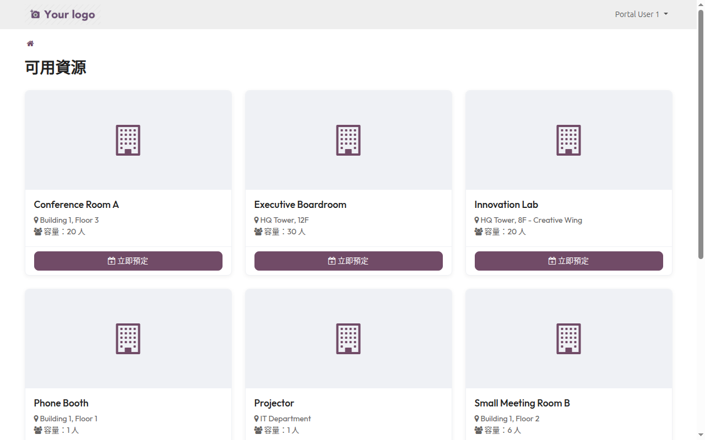
</p>

### Why This Module?

| Challenge | Solution |
|-----------|----------|
| Complex booking workflows | Portal users self-serve bookings online without contacting admins |
| Double-booking conflicts | SQL row-level locking (`FOR UPDATE`) prevents concurrent conflicts — 100% collision-free |
| No unified management view | Backend calendar view integration — all bookings at a glance |
| Scattered team communication | Auto-created discussion channel per booking for real-time collaboration |
| Insufficient security | XSS protection, IDOR validation, RPC bypass prevention, Portal record rules |
| Website module dependency | Pure Portal architecture — lightweight deployment, no Website module required |

---

## Features

### Portal User Features

- **Resource Browsing** — Card-based interface showing all bookable resources with location, capacity, and description
- **Slot Selection** — Calendar-style time slot display with booked slots auto-marked, week-by-week navigation
- **Booking Confirmation** — Enter topic, description, and optionally enable a discussion channel
- **My Bookings** — View all booking records with filtering (upcoming/all) and sorting (by date)
- **Booking Details** — Full booking information, cancel booking, re-book, and enter discussion channel
- **Discussion Channels** — Each booking can create a dedicated channel for real-time communication

### Backend Admin Features

- **Calendar View** — Day/Week/Month/Year viewing modes with color-coded resources
- **Resource Management** — Create/edit resources with category, location, capacity, slot duration, interval, and advance booking days
- **Availability Schedule** — Set daily available hours by day of week (e.g., Mon-Fri 09:00-18:00)
- **Access Control** — "All Portal Users" or "Specific Contacts" modes
- **Reservation List** — List view for managing all bookings with search, filter, and grouping
- **Advanced Settings** — Dynamic attributes (native Odoo feature), resource categories, reminder notifications

### Security & Stability

- **XSS Protection** — All user input processed via `html_sanitize`, templates use `t-out` instead of `t-raw`
- **Race Condition Prevention** — SQL `FOR UPDATE` row-level locking prevents concurrent booking conflicts
- **IDOR Protection** — Discussion channel access validation ensures only booking-related users can access
- **RPC Bypass Prevention** — Model-level constraints (`@api.constrains`) block direct RPC calls bypassing controllers
- **Portal Record Rules** — 3 `ir.rule` records restrict Portal user access to authorized resources only
- **Deletion Protection** — `partner_id` set to `ondelete='restrict'` to prevent deleting associated bookers

---

## Architecture

```
┌─────────────────────────────────────────────────────────────┐
│            Odoo Resource Booking & Reservation               │
├─────────────────────────────────────────────────────────────┤
│                                                              │
│  ┌────────────────────────┐  ┌────────────────────────┐     │
│  │    Portal Frontend     │  │   Backend Admin         │     │
│  │                        │  │                        │     │
│  │ • Resource Browsing    │  │ • Calendar View         │     │
│  │ • Slot Selection       │  │ • Reservation List/Form │     │
│  │ • Booking Confirm      │  │ • Resource Config       │     │
│  │ • My Bookings          │  │ • Category Management   │     │
│  │ • Discussion Channels  │  │ • Availability Setup    │     │
│  └──────────┬─────────────┘  └──────────┬─────────────┘     │
│             │                           │                    │
│             └───────────┬───────────────┘                    │
│                         │                                    │
│  ┌──────────────────────▼──────────────────────────────┐    │
│  │                 Core Model Layer                      │    │
│  │                                                      │    │
│  │  booking.reservation     — Booking records           │    │
│  │  booking.resource.type   — Bookable resources        │    │
│  │  booking.resource.category — Resource categories     │    │
│  │  booking.resource.availability — Availability slots  │    │
│  │                                                      │    │
│  │  Security:                                            │    │
│  │  • SQL FOR UPDATE race condition prevention           │    │
│  │  • @api.constrains model-level validation            │    │
│  │  • ir.rule Portal record rules                       │    │
│  │  • html_sanitize XSS protection                      │    │
│  └──────────────────────┬──────────────────────────────┘    │
│                         │                                    │
├─────────────────────────┼────────────────────────────────────┤
│                         ▼                                    │
│  ┌───────────────────────────────────────────────────────┐  │
│  │                 Odoo 18 Framework                      │  │
│  │  Portal │ Mail │ Calendar │ ORM │ Security             │  │
│  └───────────────────────────────────────────────────────┘  │
│                         │                                    │
│  ┌───────────────────────▼───────────────────────────────┐  │
│  │                    PostgreSQL                          │  │
│  └───────────────────────────────────────────────────────┘  │
└─────────────────────────────────────────────────────────────┘
```

### Module Dependencies

```
odoo_booking_reservation
    ├── base
    ├── mail          (Discussion channels, email notifications)
    ├── calendar      (Calendar view integration)
    ├── portal        (Portal user interface)
    └── woow_odoo_portal_discuss  (Portal discussion page)
```

---

## Screenshots

### Portal — Resource Browsing

Portal users browse all bookable resources showing name, location, and capacity.

<p align="center">
  
</p>

### Portal — Slot Selection

After selecting a resource, available time slots are displayed in calendar style. Booked slots are marked "Your Booking".

<p align="center">
  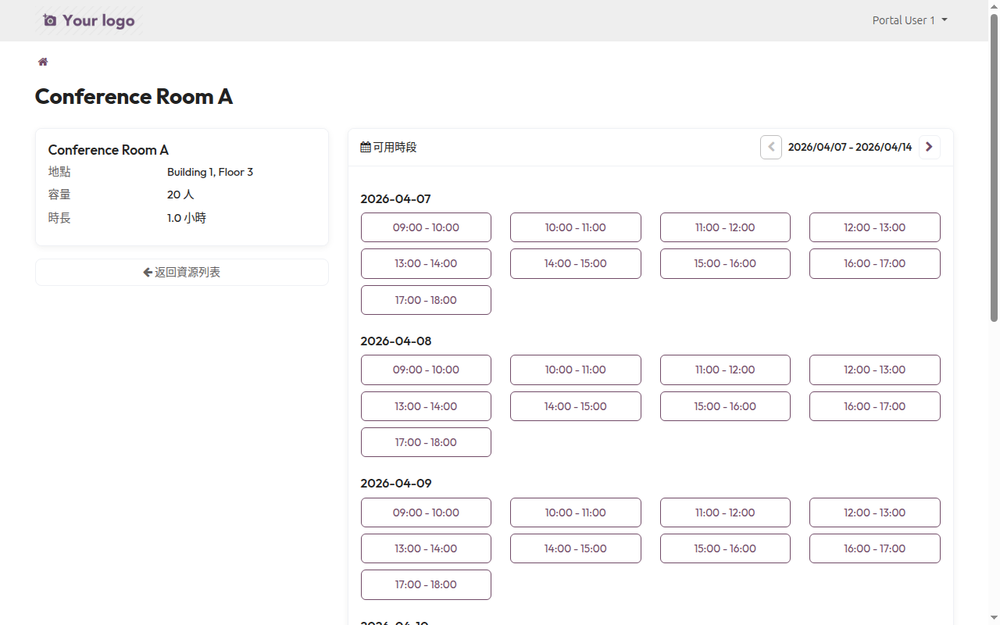
</p>

### Portal — Booking Confirmation

Enter booking topic, description, and choose whether to create a discussion channel.

<p align="center">
  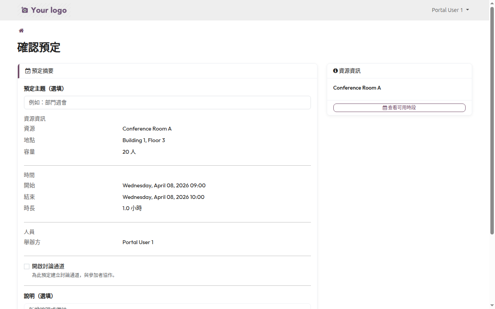
</p>

### Portal — My Bookings

View all booking records with filtering and sorting support.

<p align="center">
  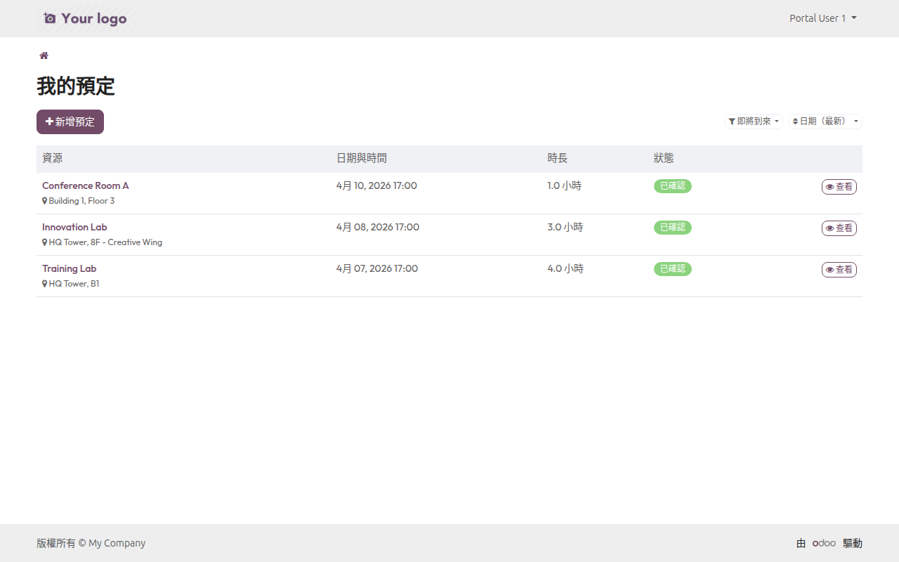
</p>

### Portal — Booking Details

Full booking information with cancel, re-book, and discussion channel access.

<p align="center">
  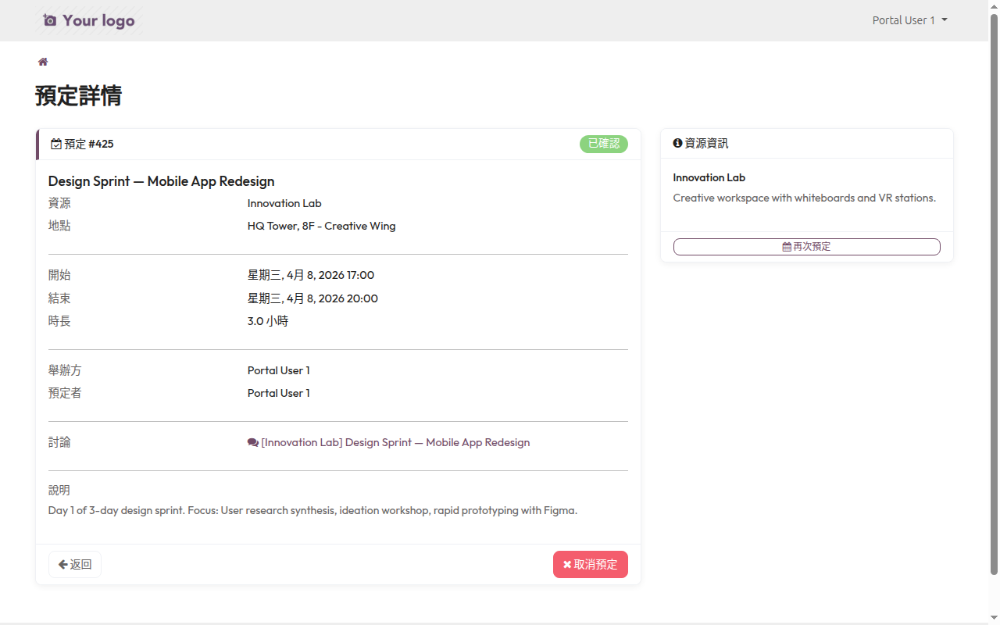
</p>

### Portal — Home Page

Portal home page shows "My Bookings" and "Book Resources" entry cards.

<p align="center">
  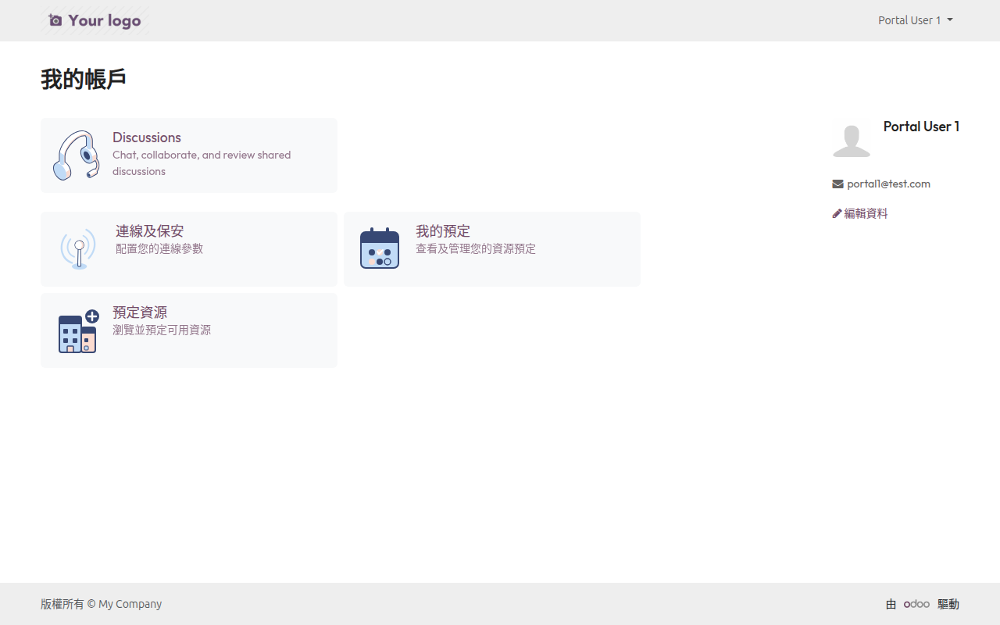
</p>

### Backend — Calendar View (Month)

Administrators view all bookings in month calendar view, color-coded by resource.

<p align="center">
  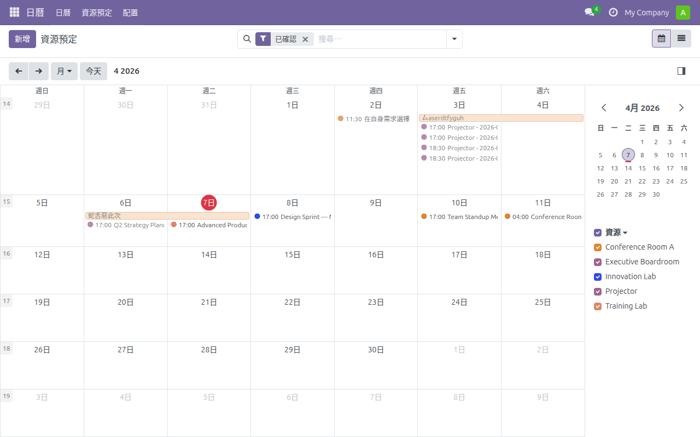
</p>

### Backend — Calendar View (Week)

Weekly calendar view showing daily slot distribution with resource filter sidebar.

<p align="center">
  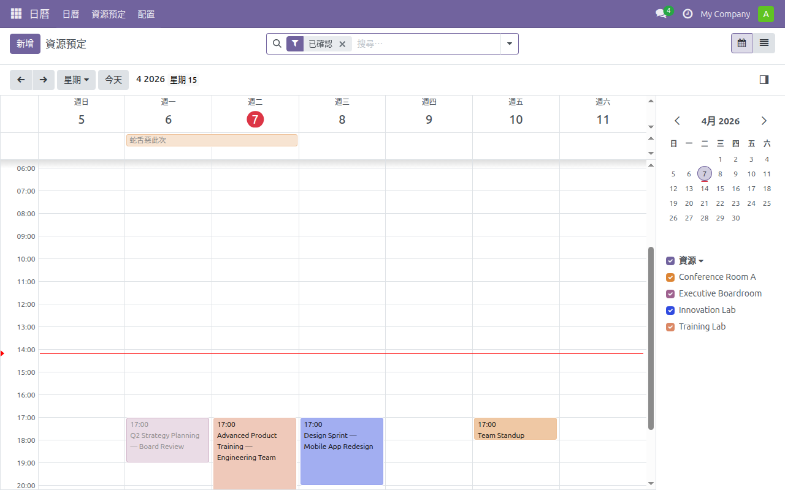
</p>

### Backend — Reservation List

List view for managing all reservations showing name, resource, time, duration, booker, and status.

<p align="center">
  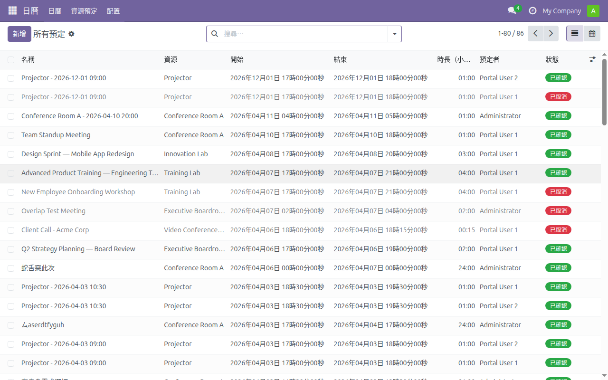
</p>

### Backend — Reservation Form

Reservation form with resource info, time, personnel (organizer/booker/attendees), discussion channel, description, and reminders.

<p align="center">
  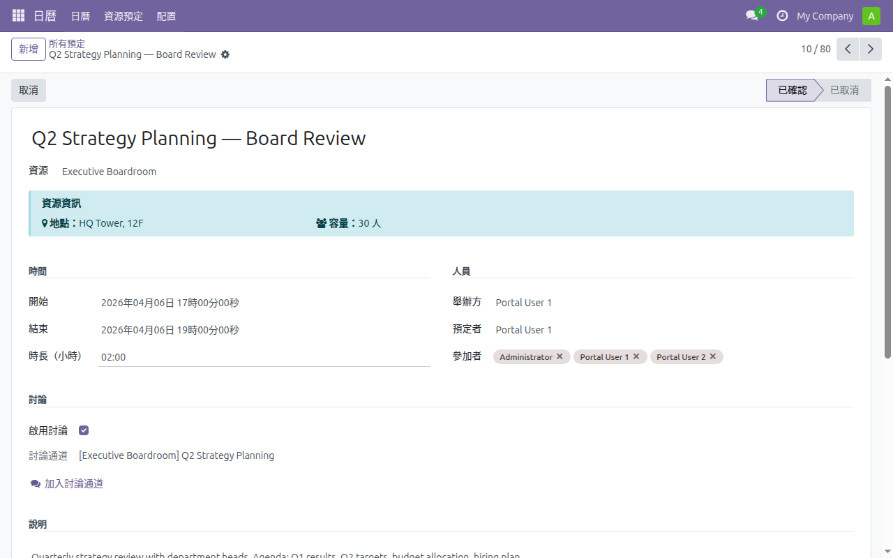
</p>

### Backend — Resource List

Resource management list showing name, location, capacity, slot duration, access type, and booking count.

<p align="center">
  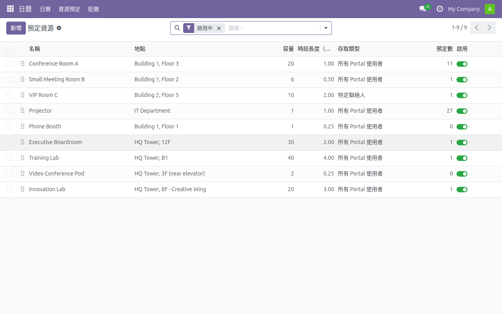
</p>

### Backend — Resource Configuration

Resource form with basic info, booking settings, description, availability schedule, access control, and advanced settings tabs.

<p align="center">
  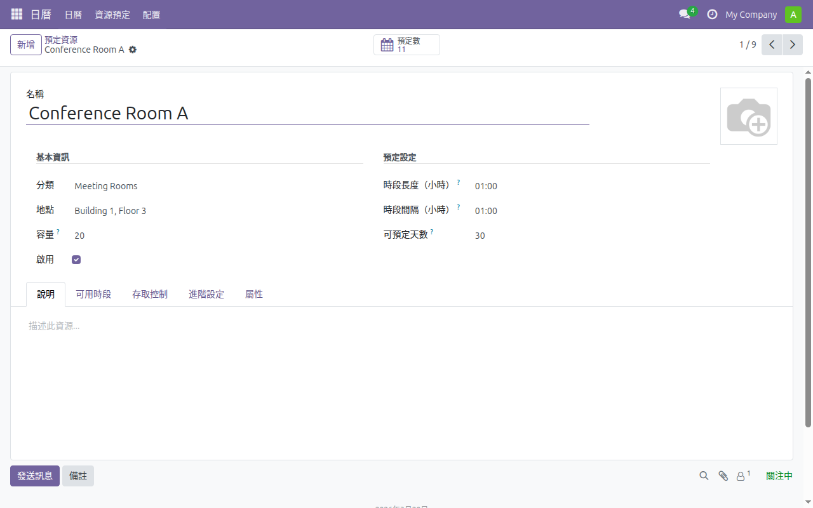
</p>

### Backend — Availability Schedule

Set daily available hours by day of week, e.g., Monday to Friday 09:00-18:00.

<p align="center">
  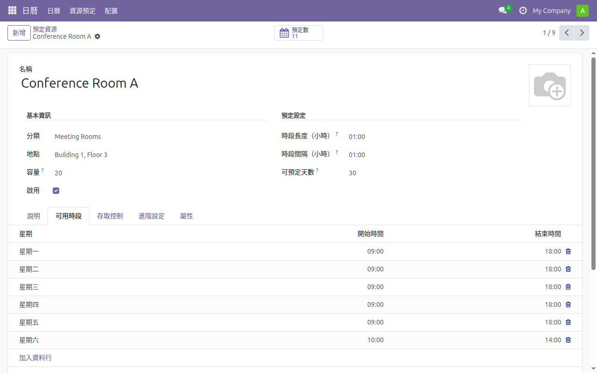
</p>

### Backend — Access Control

Configure resource access type: "All Portal Users" or "Specific Contacts".

<p align="center">
  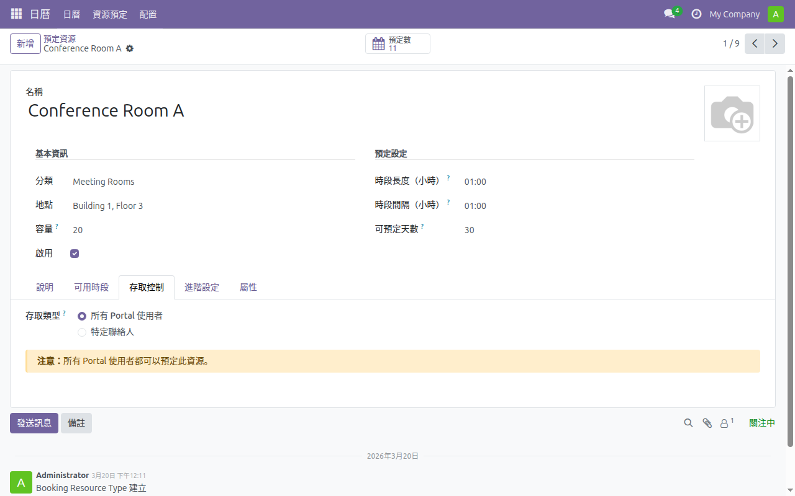
</p>

---

## Installation

### Prerequisites

- **Odoo 18.0** (Community or Enterprise)
- **PostgreSQL 13+**
- **Python 3.10+**
- **Dependencies:** `mail`, `calendar`, `portal`, `woow_odoo_portal_discuss`

### Steps

```bash
# 1. Clone the module into your Odoo addons path
cd /path/to/odoo/addons/
git clone https://github.com/WOOWTECH/Woow_odoo_internal_booking.git odoo_booking_reservation

# 2. Update module list and install
odoo -u odoo_booking_reservation -d your_database
```

### Install via Odoo UI

1. Go to **Apps** menu
2. Click **Update Apps List**
3. Search for "Resource Booking"
4. Click **Install**

---

## Configuration

### 1. Create Resource Categories

Navigate to **Calendar > Configuration > Resource Categories**

Create categories (e.g., Meeting Rooms, Equipment, Venues) for organization and filtering.

### 2. Create Bookable Resources

Navigate to **Calendar > Configuration > Booking Resources**

| Field | Description |
|-------|-------------|
| Name | Resource name (e.g., Conference Room A) |
| Category | Assigned category |
| Location | Physical location |
| Capacity | Maximum occupancy |
| Slot Duration | Length of each booking slot (hours) |
| Slot Interval | Gap between slots (minimum 0.25 hours) |
| Advance Days | How many days ahead users can book |
| Timezone | Timezone of the availability schedule. Portal slots are shown, booked and checked in this timezone, whatever timezone the portal user picked (defaults to the company timezone) |

### 3. Set Availability Schedule

On the resource form's "Availability" tab, configure daily available hours by day of week.

### 4. Configure Access Control

On the resource form's "Access Control" tab:
- **All Portal Users** — Any portal user can book
- **Specific Contacts** — Only designated contacts can book

### 5. Email Notifications

The module includes two email templates:
- **Booking Confirmed** — Sent automatically when a booking is confirmed
- **Booking Cancelled** — Sent automatically when a booking is cancelled

---

## Security

### Security Features

| Feature | Implementation |
|---------|---------------|
| XSS Protection | `html_sanitize()` on user input, `t-out` replaces `t-raw` |
| Race Condition Prevention | Bookings serialised per resource (row lock on the resource, retried on serialization failure) before the overlap check; a refused booking is rolled back (savepoint) |
| IDOR Protection | Discussion channel access validation with booking ownership check |
| Members-only Discussions | Booking discussions are `group` conversations (no `group_public_id`): only members can open, read or join them through `/discuss/channel/*`; core Odoo allows no threads in them |
| Attendee Validation | One shared domain for the attendee search and the validation: internal users plus contacts of the booker's own company (same commercial entity); search returns names only (no e-mail), needs 2+ characters, LIKE wildcards are literal; other partners are dropped by the portal and refused at model level |
| Slot Grid Enforcement | Portal bookings must match, to the second, a slot generated from the resource availability and slot interval in the resource timezone (`booking_tz`; the user's own timezone is self-writeable and is not used); backend users keep free scheduling |
| Portal Mail Recipients | Portal users cannot make other partners followers or recipients of their reservations: `message_subscribe` / `message_post` / `message_notify` keep only themselves, the participants and the attendee domain; they can only unfollow themselves |
| RPC Bypass Prevention | `@api.constrains` model-level validation (past slots, overlap, duration, attendees, slot grid); portal users have no create right and cannot write reservation fields directly (write access is kept for the portal chatter only) |
| Portal Record Rules | 3 `ir.rule` records restricting Portal access scope |
| Exception Leak Prevention | Controller catches exceptions, returns generic error codes |
| Deletion Protection | `ondelete='restrict'` prevents deleting associated bookers |
| Input Validation | Date format validation, range clamping, capacity/interval minimums |

### Portal Record Rules

```xml
<!-- Portal users can only access active, authorized resources -->
<record id="booking_resource_type_portal_rule" model="ir.rule">
    <field name="domain_force">[
        ('active', '=', True),
        '|',
        ('share_type', '=', 'all'),
        ('allowed_partner_ids', 'in', [user.partner_id.id]),
    ]</field>
    <field name="groups" eval="[(4, ref('base.group_portal'))]"/>
</record>
```

---

## Technical Details

### Model Structure

| Model | Description | Key Fields |
|-------|-------------|------------|
| `booking.reservation` | Booking records | resource_type_id, start/end_datetime, partner_id, state, channel_id |
| `booking.resource.type` | Bookable resources | name, category_id, capacity, slot_duration, slot_interval, share_type |
| `booking.resource.category` | Resource categories | name, description |
| `booking.resource.availability` | Availability slots | resource_type_id, dayofweek, hour_from, hour_to |

### Model Constraints (`@api.constrains`)

| Constraint | Description |
|------------|-------------|
| `_check_no_overlap` | Per-resource lock + parameterised overlap query prevents double-booking |
| `_check_portal_attendees` | Portal users may only invite internal users and contacts of their own company |
| `_check_portal_slot_alignment` | Portal bookings must match an offered slot |
| `_check_duration_matches_slot` | Validates booking duration matches resource slot length |
| `_check_not_in_past` | Blocks booking past time slots |
| `_check_capacity` | Resource capacity must be >= 1 |
| `_check_slot_settings` | Slot interval minimum 0.25 hours |
| `_check_availability_overlap` | Prevents overlapping availability windows |

### Performance Optimizations

- **`_read_group` aggregation** — Computed counts use `_read_group` instead of `len(filtered())` pattern
- **Native SQL queries** — Overlap checking uses raw SQL + `FOR UPDATE` to avoid ORM overhead

---

## API Reference

### Portal HTTP Endpoints

All routes require authenticated portal user (`auth='user'`).

| Endpoint | Method | Description |
|----------|--------|-------------|
| `/my/booking/resources` | GET | Browse all available resources |
| `/my/booking/resources/<id>` | GET | Resource detail with available time slots |
| `/my/booking/resources/<id>/slots` | JSON | Get available slots (params: `date_from`, `date_to`) |
| `/my/bookings/new` | GET | New booking form |
| `/my/bookings/confirm` | GET | Booking confirmation page |
| `/my/bookings/create` | POST | Create a new booking |
| `/my/bookings` | GET | List user's bookings (params: `page`, `sortby`, `filterby`) |
| `/my/bookings/<id>` | GET | Booking detail page |
| `/my/bookings/<id>/cancel` | POST | Cancel a confirmed booking |
| `/my/bookings/<id>/discuss` | GET | Redirect to booking's discussion channel |
| `/my/discussions` | GET | Portal discussions list (IDOR-protected) |

### Key Model Methods

```python
# booking.reservation
reservation.action_cancel()         # Cancel a confirmed booking
reservation.action_confirm()        # Re-confirm a cancelled booking
reservation.action_open_discuss_channel()  # Open discussion channel in Discuss

# booking.resource.type
resource._check_partner_access(partner)    # Check if partner can book
resource._generate_slots(date_from, date_to)  # Generate available time slots
resource.action_view_reservations()        # Open reservations calendar view
```

### Mail Templates

| Template ID | Trigger | Description |
|-------------|---------|-------------|
| `mail_template_booking_confirmed` | `create()` | Booking confirmation email with resource details, time, and action buttons |
| `mail_template_booking_cancelled` | `action_cancel()` | Cancellation notification with re-booking link |

---

## Testing

Odoo unit tests (`tests/`, tag `booking_security`):

```bash
odoo -d <db> -u odoo_booking_reservation --test-enable --test-tags /odoo_booking_reservation --stop-after-init
```

The older end-to-end scripts (XML-RPC / HTTP against a running server) are in
`scripts/e2e_rpc/`; they read the server, database and passwords from
environment variables (`BOOKING_E2E_URL`, `BOOKING_E2E_DB`,
`BOOKING_E2E_PASSWORD_<LOGIN>` or `BOOKING_E2E_PASSWORD`), nothing is hard-coded.

### Multi-company

Resources and reservations have no `company_id`: the module is meant for a
single-company database. In a multi-company database every portal user of
every company sees the resources shared with "All Portal Users", and Booking
Users read all reservations.

The module has been through comprehensive testing across multiple phases:

### Functional Test Results

| Phase | Test Items | Pass | Fail | Rate |
|-------|-----------|------|------|------|
| Portal End-to-End | 66 | 66 | 0 | 100% |
| Backend CRUD & Calendar | 48 | 48 | 0 | 100% |
| Security & Edge Cases | 48 | 48 | 0 | 100% |
| **Grand Total** | **162** | **162** | **0** | **100%** |

### Pre-Production Audit

23-point security and stability audit covering:

| Category | Items | Status |
|----------|-------|--------|
| XSS Protection | Template sanitization, `t-out` enforcement | Fixed |
| Race Conditions | SQL `FOR UPDATE` locking | Fixed |
| IDOR Validation | Discussion channel access checks | Fixed |
| RPC Bypass Prevention | `@api.constrains` model-level guards | Fixed |
| Portal Record Rules | 3 `ir.rule` records for resource/booking access | Fixed |
| Input Validation | Past slot blocking, overlap detection, capacity checks | Fixed |
| Deletion Protection | `ondelete='restrict'` on partner references | Fixed |
| Performance | `_read_group` aggregation, SQL optimization | Fixed |

All 23 findings identified and resolved before production release.

---

## Changelog

### v18.0.1.0.4 (2026-11)

- Namespace the calendar view registry key as `odoo_booking_reservation.booking_calendar` and update its XML `js_class` to allow coexistence with `reservation_module`.
- Upgrade `odoo_booking_reservation` in the target database and refresh backend assets together; the stored calendar view must use the new key.

### v18.0.1.0.3 (2026-11)

- **Security:** attendees of portal bookings are validated (portal and model level) against the same domain as the attendee search; the search no longer returns e-mails, only internal users and contacts of the booker's own company, and needs at least 2 characters
- **Security:** booking discussions are members-only `group` conversations; existing booking channels are converted on upgrade (migration), threads of them detached
- **Security:** portal bookings must match a slot of the resource grid; refused bookings are no longer committed; concurrent bookings of the same slot are serialised per resource
- **Security:** portal users lose the create right on reservations and cannot change reservation fields through RPC
- **Chore:** end-to-end scripts moved to `scripts/e2e_rpc/` and read credentials from the environment

### v1.0.0 (2026-04)

- **Security:** Pre-production 23-point security audit — XSS, race conditions, IDOR, RPC bypass, record rules all fixed
- **Enhancement:** Past time slot validation — `@api.constrains` blocks booking past slots
- **Enhancement:** Availability overlap detection — prevents conflicting availability windows on same resource
- **Enhancement:** Performance optimization — `_read_group` aggregation replaces `len(filtered())` pattern
- **Enhancement:** Deletion protection — `ondelete='restrict'` on `partner_id` prevents orphaned records
- **Localization:** Complete Traditional Chinese interface — all views, templates, controllers, error messages, field labels
- **Fix:** Discussion channel dialog — pure DOM approach ensures reliable close button behavior
- **Fix:** Timezone handling — slot generation correctly converts between user timezone and UTC
- **Fix:** Portal home page card icons and layout alignment

### v0.9.0 (2026-03)

- **Feature:** Calendar-style booking form with topic, organizer, attendees, and Discussion channel integration
- **Feature:** Portal brand redesign — Woowtech brand colors and typography applied
- **Feature:** Discussion channel auto-creation per booking with attendee membership
- **Feature:** Email notification templates — booking confirmation and cancellation
- **Testing:** 162/162 comprehensive tests passed (100%)

### v0.1.0 (2026-02)

- **Initial Release:** Complete resource booking module for Odoo 18
- **Feature:** Portal self-service resource browsing, slot selection, booking confirmation
- **Feature:** Backend calendar view with day/week/month/year modes
- **Feature:** Resource management with categories, capacity, availability schedules, access control
- **Feature:** Pagination, sorting, filtering on booking lists

---

## License

This project is licensed under **LGPL-3**.

---

## Support

- **Company:** [WOOWTECH](https://woowtech.com)
- **Email:** gt.apps.odoo@gmail.com
- **Issues:** [GitHub Issues](https://github.com/WOOWTECH/Woow_odoo_internal_booking/issues)

---

<p align="center">
  <sub>Built with care by <a href="https://github.com/WOOWTECH">WOOWTECH</a> &bull; Powered by Odoo 18</sub>
</p>
